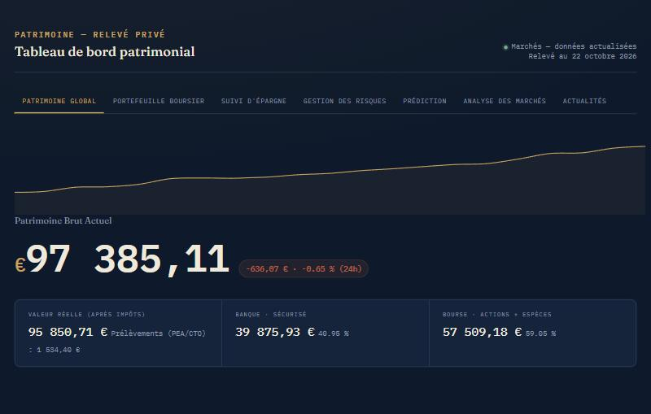
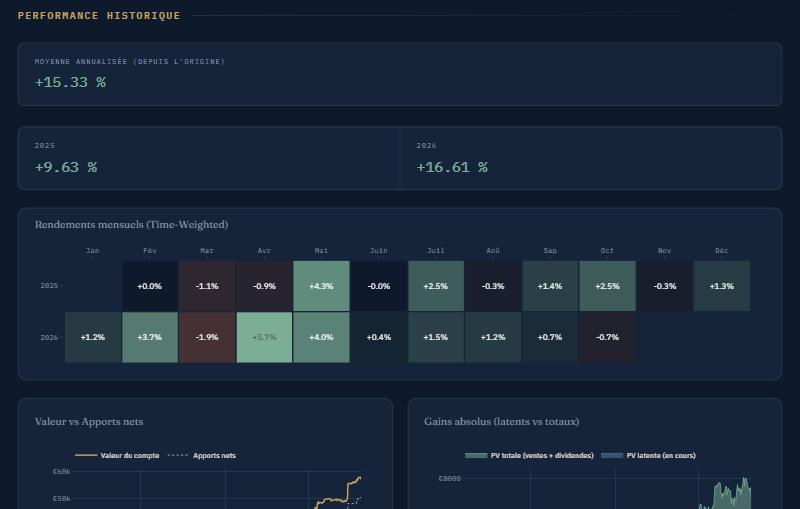
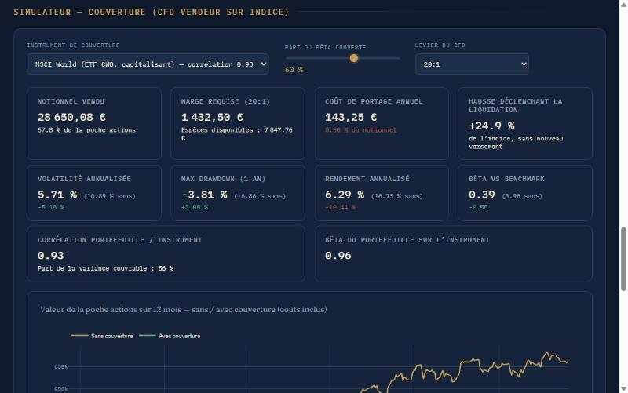
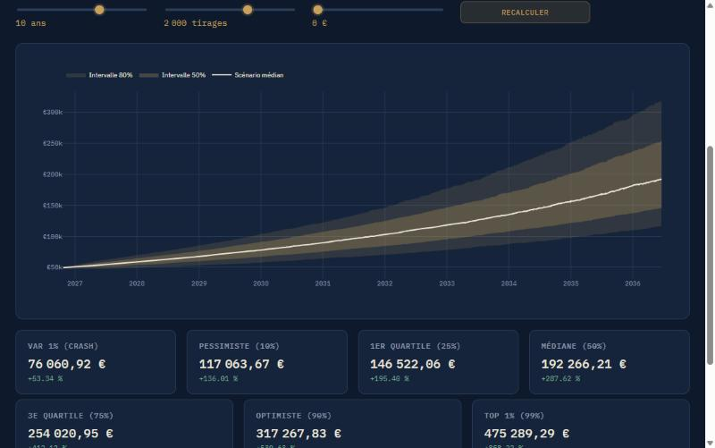
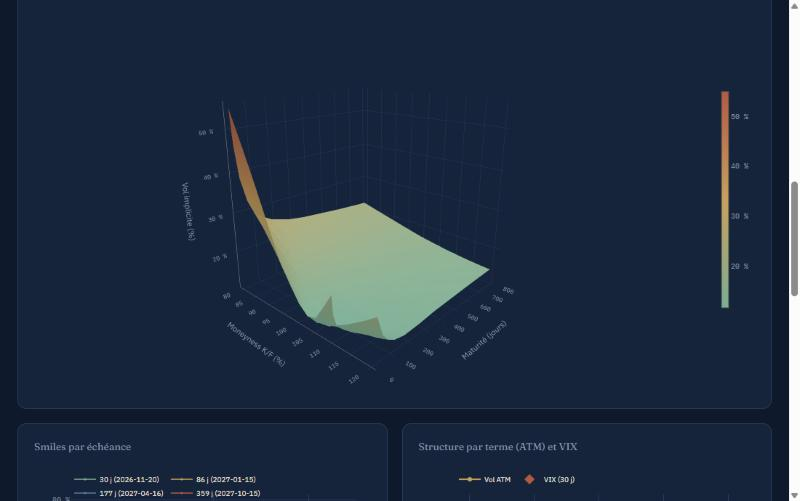
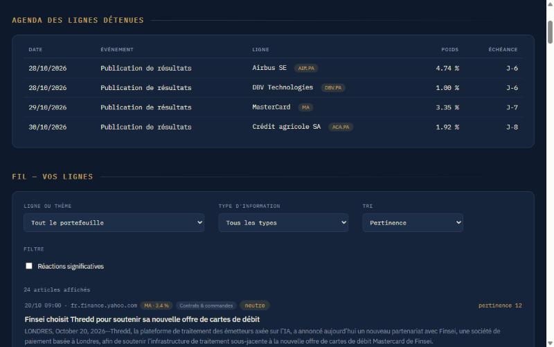
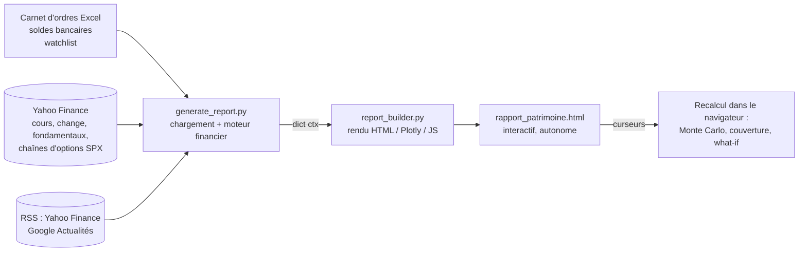

# Portfolio Risk Dashboard

**Un terminal d'analyse et de risque construit pour un portefeuille actions personnel (PEA + compte-titres) :
performance time-weighted, fiscalité par enveloppe, Monte Carlo GJR-GARCH, simulateur de couverture du bêta par
CFD, surface de volatilité implicite du S&P 500 et veille d'actualités avec mesure de la réaction des cours.**

Python calcule tout à partir d'un carnet d'ordres Excel et des données de marché (Yahoo Finance) ; le résultat est
un rapport HTML interactif unique (Plotly + JavaScript) dont les curseurs recalculent risque, couverture et
simulations directement dans le navigateur.

🇬🇧 [English version](README.md) · 🖥️ **Démo en ligne :** [rlekmine-oa.github.io/Financial-Dashboard](https://rlekmine-oa.github.io/Financial-Dashboard/)
(portefeuille de démonstration anonymisé : quantités multipliées par un facteur aléatoire propre à chaque ligne,
dates décalées, montants recalculés aux cours de marché)



---

## Fonctionnalités

| Domaine | Ce que ça fait | Techniques |
|---|---|---|
| **Performance** | Performance réelle, indépendante des versements et retraits | Indice de rendement time-weighted (TWR) journalier, heatmap mensuelle, rendement annualisé, attribution du P&L, réplication du benchmark à flux identiques |
| **Fiscalité** | Valeur nette après impôt | Taux 2026 (PFU 31,4 % / prélèvements sociaux 18,6 %), impôt calculé **par enveloppe** (compensation des moins-values dans le CTO, le PEA, le PEA-PME), règle des 5 ans du PEA |
| **Risque** | Risque de l'allocation *actuelle* | Volatilité, Sharpe, Sortino (downside deviation), Calmar, bêta, matrice de corrélation, max drawdown, **stress tests ajustés du bêta**, simulateur d'ajout d'un titre de la watchlist |
| **Monte Carlo** | Projections de 1 à 15 ans avec versements mensuels | **GJR-GARCH(1,1) à innovations de Student** par actif, simulation jointe à corrélation constante (CCC) via une Student multivariée ; repli sur bootstrap par blocs ; calcul en JS dans le navigateur |
| **Couverture** | Coût et bénéfice d'une couverture du bêta par un CFD vendeur sur indice | Ratio de couverture à variance minimale (bêta du portefeuille sur l'instrument), levier ESMA et clôture à 50 % de marge, coût de portage (spread − taux de référence + dividendes de l'indice), seuil de liquidation, risque de base (corrélation / R²), backtest et stress tests avec et sans couverture, dont un rallye |
| **Surface de volatilité** | Vraie surface de volatilité implicite des options S&P 500 (sous-jacent du VIX) | IV **recalculées en Black-76** (celles de Yahoo sont inutilisables hors séance US), forward par parité call-put (**méthode CBOE du VIX**), options hors de la monnaie uniquement, filtre robuste (MAD) des points aberrants, aucune extrapolation, structure par terme ATM, skew 90/110, écart VIX / ATM |
| **Actualités** | Veille de type institutionnel sur les lignes détenues | Flux RSS par ligne + thèmes pondérés par l'exposition des ETF, classification par mots-clés (résultats, prévisions, M&A, analystes, juridique…), **détection de mention directe**, **étude d'événement** : rendement anormal vs benchmark à la première séance utile (selon l'heure de clôture de la place) avec z-score, score de pertinence, agenda résultats / dividendes, alertes |
| **Régime de marché** | Contexte pour les points d'entrée | Régime du VIX (seuils, moyenne 20 jours, historique 2 ans), screener fondamental interactif (PER, ROE, endettement, croissance, momentum 6 mois, distance à la MM200) |

## Captures

| Performance time-weighted | Simulateur de couverture par CFD |
|---|---|
|  |  |
| **Monte Carlo GJR-GARCH** | **Surface de volatilité implicite S&P 500** |
|  |  |
| **Fil d'actualité et agenda** | |
|  | |

## Choix de conception

- **Aucune donnée inventée ni biais d'anticipation.** Les rendements ne sont calculés que sur la période de
  cotation réelle de chaque actif (ffill limité aux jours fériés, jamais de bfill). Recopier un cours avant
  l'introduction en bourse crée des rendements nuls qui sous-estiment volatilité et corrélations ; les métriques
  de covariance n'utilisent que la période commune, affichée. Un test vérifie que l'ancienne méthode créait
  600 rendements nuls artificiels.
- **Drawdown calculé sur l'indice TWR**, pas sur la valeur du compte : un versement ne masque plus une perte et un
  retrait ne crée plus de faux drawdown (testé : −20 % dans les trois cas contre 0 % / −70 % avec la méthode naïve).
- **Impôt par enveloppe**, comme le prévoit le droit fiscal (compensation des moins-values), puis réparti sur les
  lignes au prorata des plus-values positives pour que les totaux restent cohérents.
- **Hygiène des données d'options.** Milieu bid/ask quand il existe, sinon dernier prix de la dernière séance
  uniquement ; forward par parité aux strikes où |C − P| est minimal (estimer aussi l'actualisation par régression
  donnait des taux implicites de plus de 300 % sur les échéances courtes, à cause des prix non synchrones).
- **Actualité ≠ causalité.** Un mouvement de cours n'est rattaché qu'à un article qui cite la société, et n'est
  signalé qu'au-delà de 2 écarts-types de son écart quotidien habituel au benchmark.
- **Séparation calcul / rendu.** `generate_report.py` contient le chargement et toute la logique financière ;
  `report_builder.py` ne fait que le rendu (HTML/CSS, Plotly, JS). Le texte externe (titres d'articles) est
  échappé ou inséré via `textContent`, les données JSON sont protégées contre l'injection de `</script>`.

## Architecture



| Fichier | Rôle | Lignes |
|---|---|---|
| `generate_report.py` | Chargement, moteur de portefeuille, risque, fiscalité, calibration Monte Carlo, surface de volatilité, analyse des actualités | ~2 400 |
| `report_builder.py` | Rendu : CSS, graphiques Plotly, JS interactif (moteur MC, couverture, what-if, filtres d'actualités) | ~1 500 |
| `tests/test_synthetique.py` | 9 tests hors ligne sur données synthétiques (fiscalité, absence de bfill, GARCH, TWR, bêta de couverture, reconstitution des IV, actualités) | ~390 |

## Démarrage rapide

```bash
python -m venv .venv
# Windows : .venv\Scripts\activate    macOS/Linux : source .venv/bin/activate
pip install -r requirements.txt

python generate_report.py --data-dir data/demo     # écrit rapport_patrimoine.html
python tests/test_synthetique.py                   # ou : python -m pytest
```

Une connexion Internet est nécessaire (cours, chaînes d'options, flux RSS). Les fondamentaux (24 h), la surface de
volatilité (6 h) et les actualités (1 h) sont mis en cache ; en cas d'échec réseau, le cache périmé est utilisé et
signalé dans le rapport.

Pour vos propres données, placez les trois fichiers Excel dans un dossier au même format que `data/demo/` et
passez-le avec `--data-dir`. Les paramètres (taux d'imposition, date d'ouverture du PEA, benchmark, coûts de
couverture, thèmes d'actualité…) sont des constantes en tête de `generate_report.py`.

### Format des fichiers d'entrée

| Fichier | Contenu |
|---|---|
| `Stratégie et Feuille de Route_Bourse.xlsx` (ou `.xlsm`) | Feuille `Historique_Ordres` : date, type d'ordre (Achat / Vente / Virement / Dividende), compte (PEA, CTO, PEA-PME), actif, ticker, quantité, montant frais inclus. La ligne d'en-tête est détectée automatiquement. Les retraits sont saisis comme des virements négatifs. |
| `Comptes.xlsx` | Soldes bancaires : `Date`, `Compte`, `Montant` |
| `Stock_list.xlsx` | Watchlist : `Symbol`, `Suffixe` optionnel (ex. `.PA`) |

## Limites

- La dérive du Monte Carlo est calibrée sur l'historique réalisé (pas d'ajustement d'équilibre ni risque-neutre) :
  après une forte hausse des marchés, les projections sont optimistes. Le GARCH nécessite le paquet `arch`, sinon
  le bootstrap par blocs est utilisé.
- Yahoo Finance et les flux RSS sont gratuits mais non officiels et peuvent changer sans préavis.
- Le type et le sentiment des actualités reposent sur des lexiques de mots-clés : ils sont indicatifs.
- Hors séance américaine, la surface de volatilité repose sur des derniers prix non synchrones et est plus bruitée.

## Stack technique

Python (pandas, NumPy, arch, yfinance, openpyxl) · Plotly · JavaScript · GitHub Actions (tests).

---

*Projet personnel. Le portefeuille de démonstration est anonymisé (quantités, dates et montants brouillés). Rien ici ne constitue un conseil en investissement.*
Auteur : Rayan LEKMINE · Licence : [MIT](LICENSE)
