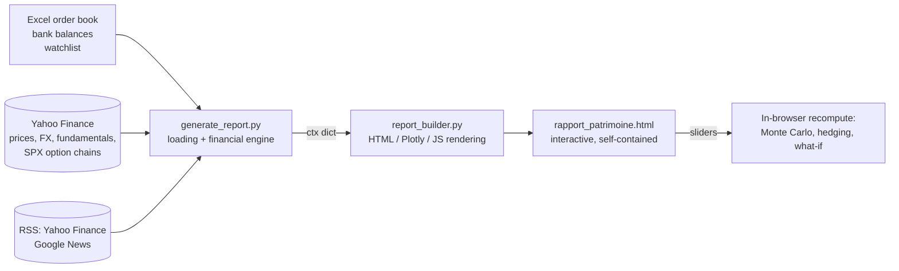

# Portfolio Risk Dashboard

**A self-built risk and analytics terminal for a personal equity portfolio (French PEA + brokerage account):
time-weighted performance, envelope-level tax, GJR-GARCH Monte Carlo, beta-hedging simulator with CFDs,
S&P 500 implied volatility surface and a portfolio-aware news flow with event-study price reactions.**

Python computes everything from an Excel order book and market data (Yahoo Finance); the output is a single
interactive HTML report (Plotly + vanilla JS) whose sliders recompute risk, hedging and simulations in the browser.

🇫🇷 [Version française](README.fr.md) · 🖥️ **Live demo:** [rlekmine-oa.github.io/Financial-Dashboard](https://rlekmine-oa.github.io/Financial-Dashboard/)
(anonymised demo portfolio: per-position quantities rescaled by random factors, dates shifted, amounts recomputed
at market prices) · The interface is in French.


---

## Highlights

| Area | What it does | Techniques |
|---|---|---|
| **Performance** | True investment performance, independent of deposits/withdrawals | Daily time-weighted return (TWR) index, monthly heatmap, annualised return, P&L attribution, benchmark replication with identical cash flows |
| **Tax** | After-tax value of the portfolio | French 2026 rates (PFU 31.4 % / social levies 18.6 %), tax computed **per envelope** (losses offset gains within CTO, PEA, PEA-PME), 5-year PEA rule |
| **Risk** | Risk of the *current* allocation | Volatility, Sharpe, Sortino (downside deviation), Calmar, beta, correlation matrix, max drawdown, **beta-adjusted stress tests**, what-if simulator for adding a watchlist stock |
| **Monte Carlo** | 1–15 year projections with monthly contributions | **GJR-GARCH(1,1) with Student-t innovations** per asset, constant-correlation (CCC) joint simulation via multivariate Student-t; block-bootstrap fallback; runs client-side in JS |
| **Hedging** | Cost/benefit of hedging equity beta with a short index CFD | Minimum-variance hedge ratio (portfolio beta on the instrument), ESMA leverage and 50 % margin close-out, carry (financing spread − reference rate + index dividends), liquidation threshold, basis risk (correlation / R²), hedged vs unhedged backtest and stress tests incl. a rally |
| **Volatility surface** | Real implied-vol surface of S&P 500 options (VIX underlying) | IVs **re-computed with Black-76** (Yahoo's are unusable outside US hours), forward from put-call parity (**CBOE VIX methodology**), OTM options only, robust MAD outlier filter, no extrapolation, ATM term structure, 90/110 skew, VIX vs ATM spread |
| **News flow** | Institutional-style news monitoring of the holdings | RSS per holding + theme feeds weighted by ETF exposure, keyword classification (earnings, guidance, M&A, analysts, legal…), **direct-mention detection**, **event study**: abnormal return vs benchmark on the first tradable session (exchange close-aware) with z-score, relevance score, earnings / ex-dividend calendar, alerts |
| **Market regime** | Context for entry points | VIX regime (thresholds, 20-day average, 2-year history), interactive fundamental screener (P/E, ROE, leverage, growth, 6-month momentum, distance to 200-day MA) |

## Screenshots

| Time-weighted performance | CFD hedging simulator |
|---|---|
|  |  |
| **GJR-GARCH Monte Carlo** | **S&P 500 implied volatility surface** |
|  |  |
| **Portfolio news flow & event calendar** | |
|  | |

## Design choices worth noting

- **No look-ahead or invented data.** Returns are computed only over each asset's real trading history
  (forward-fill limited to holidays, never back-fill). Back-filling prices before an IPO creates zero returns
  that understate volatility and correlation; covariance-based metrics use the common period only, and the
  calibration window is displayed. A unit test checks that the old approach created 600 artificial zero returns.
- **Drawdown on the TWR index**, not on account value: a deposit no longer masks a loss and a withdrawal no
  longer creates a fake drawdown (tested: −20 % in all three cases vs 0 % / −70 % with the naïve method).
- **Tax per envelope**, as the French tax code works (losses offset gains), then allocated back to positions
  pro rata of positive gains so line-level figures still add up.
- **Option data hygiene.** Mid price when a quote exists, otherwise only last trades from the latest session;
  forward from parity at the strikes where |C − P| is minimal (estimating discounting by regression gave
  implied rates above 300 % on short maturities because of asynchronous prices).
- **News ≠ causality.** A price move is only attached to an article that actually names the company, and only
  flagged when the abnormal return exceeds 2σ of its usual daily spread vs the benchmark.
- **Separation of concerns.** `generate_report.py` holds data loading and all financial logic;
  `report_builder.py` only renders (HTML/CSS, Plotly, JS). External text (news titles) is escaped or inserted
  with `textContent`, JSON payloads are protected against `</script>` injection.

## Architecture



| File | Role | Lines |
|---|---|---|
| `generate_report.py` | Data loading, portfolio engine, risk, tax, Monte Carlo calibration, vol surface, news analytics | ~2 400 |
| `report_builder.py` | Rendering: CSS, Plotly figures, interactive JS (MC engine, hedging, what-if, news filters) | ~1 500 |
| `tests/test_synthetique.py` | 9 offline tests on synthetic data (tax, no back-fill, GARCH plumbing, TWR, hedge beta, IV recovery, news) | ~390 |

## Quick start

```bash
python -m venv .venv
# Windows: .venv\Scripts\activate    macOS/Linux: source .venv/bin/activate
pip install -r requirements.txt

python generate_report.py --data-dir data/demo     # writes rapport_patrimoine.html
python tests/test_synthetique.py                   # or: python -m pytest
```

Internet access is required (market data, option chains, RSS). Fundamentals (24 h), the volatility surface (6 h)
and news (1 h) are cached locally; on network failure the stale cache is used and flagged in the report.

To use your own data, put the three Excel files in a folder with the same layout as `data/demo/` and pass it with
`--data-dir`. Parameters (tax rates, PEA opening date, benchmark, hedging costs, news themes…) are constants at the
top of `generate_report.py`.

### Input format

| File | Content |
|---|---|
| `Stratégie et Feuille de Route_Bourse.xlsx` (or `.xlsm`) | Sheet `Historique_Ordres`: date, order type (Achat / Vente / Virement / Dividende), account (PEA, CTO, PEA-PME), asset, ticker, quantity, amount incl. fees. The header row is detected automatically. Withdrawals are entered as negative transfers. |
| `Comptes.xlsx` | Bank balances: `Date`, `Compte`, `Montant` |
| `Stock_list.xlsx` | Watchlist: `Symbol`, optional `Suffixe` (e.g. `.PA`) |

## Limitations

- Monte Carlo drift is calibrated on realised history (no equilibrium or risk-neutral adjustment): after a strong
  market, projections are optimistic. The `arch` package is needed for GARCH; otherwise block bootstrap is used.
- Yahoo Finance and RSS feeds are free but unofficial and can change without notice.
- News types and sentiment rely on keyword lexicons: indicative only.
- Outside US trading hours the volatility surface relies on non-synchronous last prices and is noisier.

## Tech stack

Python (pandas, NumPy, arch, yfinance, openpyxl) · Plotly · vanilla JavaScript · GitHub Actions (tests).

---

*Personal project. The demo portfolio is anonymised (randomised quantities, dates and amounts). Nothing here is investment advice.*
Author: Rayan LEKMINE · License: [MIT](LICENSE)
